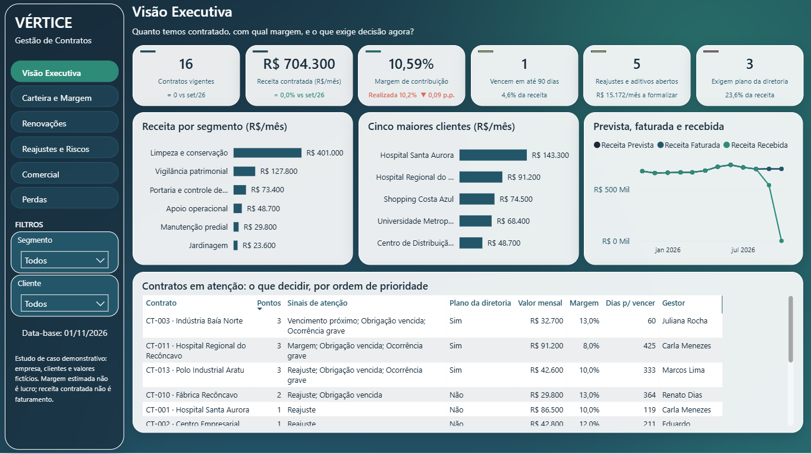
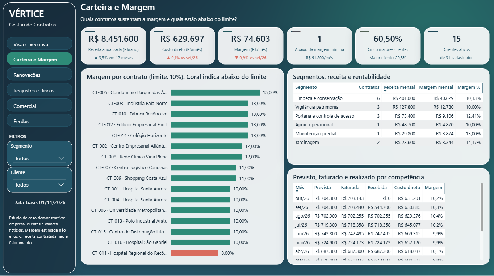
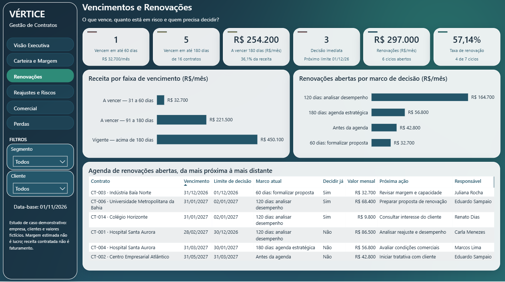
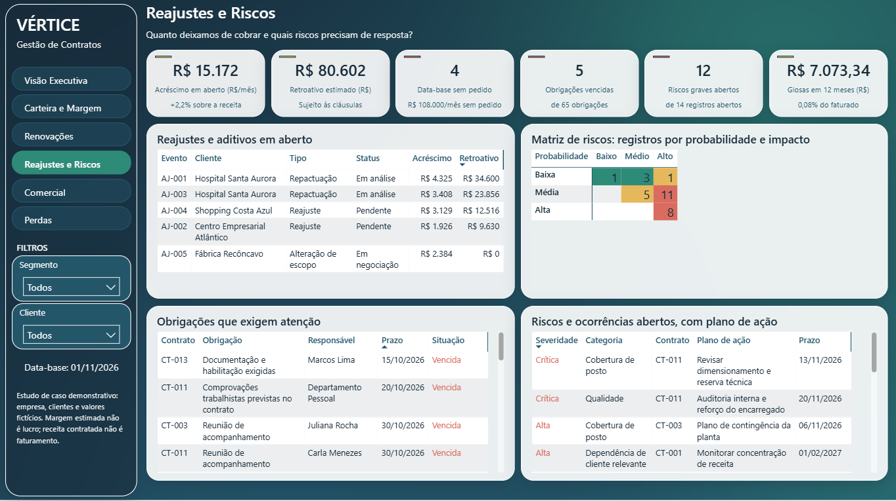
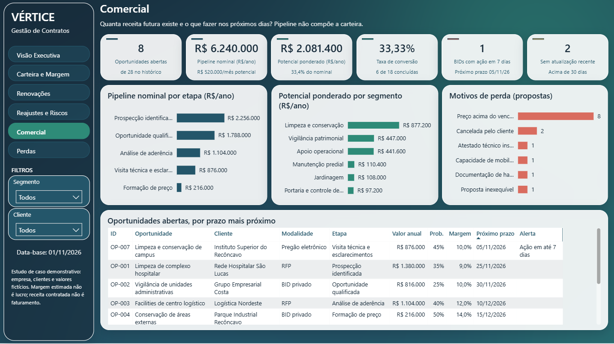
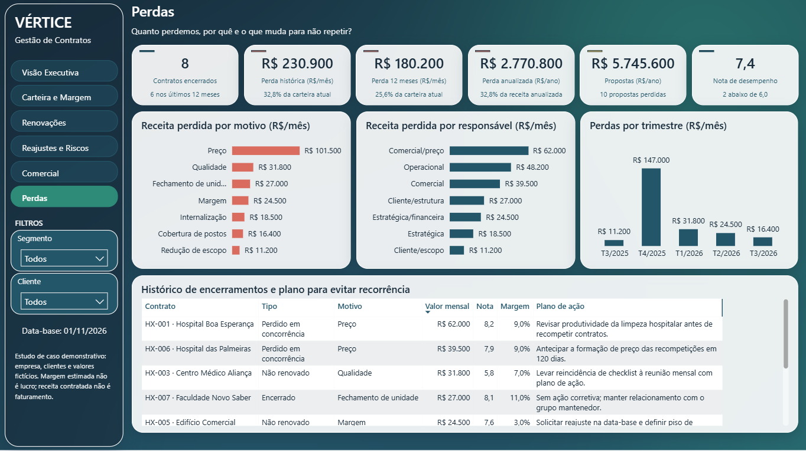

# Gestão de Contratos: dashboard em Power BI

Dashboard gerencial da carteira de contratos de uma empresa de facilities, da oportunidade comercial ao encerramento. É a continuação visual do [controle em Excel](https://github.com/Gabriiel-Barbosa/contratos_vertice_facilities), que segue como base de dados e fonte das regras de negócio.

**Projeto concebido e modelado por Gabriel Barbosa.**



> **Estudo de caso demonstrativo.** A Vértice Facilities, seus clientes, fornecedores, pessoas, contratos e oportunidades são fictícios. Os resultados são simulados e não representam experiência profissional em uma empresa real.

- **Ferramenta:** Power BI Desktop
- **Fonte de dados:** `Vertice_Gestao_Contratos.xlsx`
- **Data-base do cenário:** 01/11/2026
- **Estrutura:** 6 telas, 6 tooltips de página e modelo em estrela

## O problema de gestão

O controle em Excel organizou a carteira e padronizou as regras, mas foi desenhado para a reunião mensal: é tabular e exige conhecer as abas. A diretoria precisava enxergar em poucos segundos o que está contratado, o que vence, o que deixou de ser cobrado e onde decidir.

O dashboard parte das mesmas perguntas de negócio e organiza as respostas por categoria. Cada tela abre com a pergunta que responde e termina em uma lista de ação, com responsável e prazo.

## As telas

### Visão Executiva

*Quanto temos contratado, com qual margem, e o que exige decisão agora?*

Resume a carteira, mostra onde a receita está concentrada e ordena os contratos por pontos de atenção.

### Carteira e Margem

*Quais contratos sustentam a margem e quais estão abaixo do limite?*

Compara a margem por contrato com o limite de 10% e separa o que foi previsto, faturado e recebido em cada competência.



### Vencimentos e Renovações

*O que vence, quanto está em risco e quem precisa decidir?*

Mostra a receita por faixa de vencimento, o valor em cada marco de decisão e a agenda de renovações com próxima ação e responsável.



### Reajustes e Riscos

*Quanto deixamos de cobrar e quais riscos precisam de resposta?*

Reúne reajustes e aditivos em aberto, matriz de probabilidade e impacto, obrigações vencidas e planos de ação.



### Comercial

*Quanta receita futura existe e o que fazer nos próximos dias?*

Apresenta pipeline nominal e ponderado separados, motivos de perda e oportunidades por prazo. O pipeline não compõe a carteira contratada.



### Perdas

*Quanto perdemos, por quê e o que muda para não repetir?*

Analisa a receita perdida por motivo, responsável e trimestre, junto com o plano para evitar recorrência.



## O que o dashboard revelou no cenário

Situação simulada na data-base de 01/11/2026.

| Indicador | Valor |
|---|---|
| Contratos vigentes | 16, com 15 clientes |
| Receita mensal contratada | R$ 704.300 |
| Margem de contribuição | R$ 74.603 por mês (10,59%) |
| Cinco maiores clientes | 60,50% da receita |
| Receita vencendo em 180 dias | R$ 254.200 (36,09%) |
| Receita perdida em 12 meses | R$ 180.200 por mês |
| Pipeline nominal | R$ 6.240.000 por ano |
| Pipeline ponderado | R$ 2.081.400 por ano |

Principais leituras:

- **Decisão:** CT-003, CT-011 e CT-013 acumulam três sinais de atenção cada e, juntos, representam 23,6% da receita.
- **Margem:** CT-011 opera com 8%, abaixo do limite de 10%, e é o contrato com mais ocorrências.
- **Cobrança:** R$ 15.172 por mês estão em eventos abertos, com R$ 80.602 de retroativo estimado, sujeito às cláusulas. Outros quatro contratos passaram da data-base sem pedido registrado.
- **Risco:** 12 dos 14 registros abertos têm severidade alta ou crítica.
- **Perdas:** preço explica R$ 101.500 dos R$ 230.900 mensais perdidos no histórico.

## Modelagem

Os dados vêm das Tabelas do Excel por Power Query, em um modelo em estrela com relacionamentos de um para muitos e filtro em direção única.

| Tipo | Tabelas |
|---|---|
| Dimensões | `dCalendario`, `dCliente`, `dContrato`, `dSegmento`, `dEtapa` |
| Fatos | `fCarteira`, `fItens`, `fFinanceiro`, `fEventos`, `fObrigacoes`, `fOcorrencias`, `fRenovacoes`, `fOportunidades`, `fEncerrados` |
| Apoio | `Parametros`, `_Medidas` |

Decisões de modelagem:

- **Dimensão única de contrato:** `dContrato` reúne contratos vigentes, encerrados e a oportunidade com risco registrado, para que financeiro, ocorrências e renovações respondam aos mesmos filtros.
- **Fonte única das regras:** faixas de vigência, sinais de atenção e severidade continuam calculados no Excel. O DAX agrega, sem duplicar a lógica.
- **Medidas organizadas:** ficam em tabela própria, separadas em pastas por assunto, com descrição nas principais.
- **Colunas técnicas ocultas:** chaves e campos de ordenação não aparecem para quem constrói os visuais.
- **Data-base controlada:** prazos seguem o parâmetro `Data_Referencia`, nunca a data do computador.

## Projeto em TMDL

O relatório está salvo como projeto do Power BI (`.pbip`), em arquivos de texto, em vez de um único `.pbix` binário. O modelo semântico usa **TMDL** (Tabular Model Definition Language), a linguagem que descreve tabelas, colunas, medidas e relacionamentos de forma legível. As páginas e os visuais ficam em JSON, no formato PBIR.

```text
dashboard/
├── Vertice_Gestao_Contratos.pbip
├── Vertice_Gestao_Contratos.SemanticModel/
│   └── definition/
│       ├── model.tmdl            configurações do modelo
│       ├── expressions.tmdl      parâmetro e fonte de dados
│       ├── relationships.tmdl    relacionamentos
│       └── tables/               uma tabela por arquivo
└── Vertice_Gestao_Contratos.Report/
    └── definition/pages/         páginas e visuais
```

Uma medida em TMDL fica assim:

```text
measure 'Margem %' = DIVIDE([Margem Mensal], [Receita Mensal Contratada])
    formatString: 0.00%
    displayFolder: 1. Carteira
```

Por que usei esse formato:

- **Versionamento:** o Git mostra exatamente qual medida, coluna ou visual mudou.
- **Revisão:** o modelo pode ser lido sem abrir o Power BI.
- **Organização:** cada tabela fica em um arquivo, o que facilita localizar alterações.
- **Portfólio:** quem visita o repositório consegue avaliar a modelagem direto no código.

Os dados carregados ficam em `.pbi/cache.abf`, que não é versionado. Por isso o projeto precisa de uma atualização na primeira abertura.

## Principais funções DAX

O modelo tem 174 medidas, organizadas em pastas. A maior parte das regras vem pronta do Excel, então o DAX concentra agregação, contexto de filtro e apresentação.

| Grupo | Funções | Medidas | Uso no projeto |
|---|---|---|---|
| Contexto de filtro | `CALCULATE` | 60 | Aplica condições como contrato vigente ou evento aberto |
| Agregação | `SUM`, `COUNTROWS`, `DISTINCTCOUNT`, `AVERAGE` | 73 | Soma valores e conta registros |
| Divisão segura | `DIVIDE` | 25 | Calcula margem e participação sem erro de divisão por zero |
| Variáveis | `VAR` / `RETURN` | 18 | Deixa o cálculo legível e evita repetir expressões |
| Datas | `DATE`, `EDATE`, `YEAR`, `MONTH`, `DATEADD` | 15 | Localiza a competência atual, o mês anterior e a janela de 12 meses |
| Texto | `FORMAT`, `SELECTEDVALUE` | 49 | Monta subtítulos dos cartões e títulos dos tooltips |
| Ranking | `TOPN`, `RANKX`, `SUMX`, `MAXX` | 8 | Calcula os cinco maiores clientes e as listas Top 4 |
| Controle de filtros | `ALL`, `ALLSELECTED`, `KEEPFILTERS`, `FILTER`, `VALUES`, `CROSSFILTER` | 16 | Define o total de referência e respeita a seleção do usuário |
| Lógica | `IF`, `SWITCH`, `COALESCE`, `ISBLANK` | 24 | Define cores de status, setas e textos alternativos |

A coluna **Medidas** mostra em quantas medidas ao menos uma função do grupo aparece. Como uma medida usa várias funções, os valores não somam 174.

Três exemplos do modelo:

```dax
-- Receita somente dos contratos vigentes
Receita Mensal Contratada =
CALCULATE(SUM(fCarteira[Valor mensal]), fCarteira[Vigente] = 1)

-- Receita dos cinco maiores clientes, respeitando os filtros
Receita Top 5 Clientes =
SUMX(
    TOPN(5, VALUES(dCliente[Cliente ID]), [Receita Mensal Contratada], DESC),
    [Receita Mensal Contratada]
)

-- Variação do faturamento contra o mês anterior
TT Var Faturada =
DIVIDE([Receita Faturada], CALCULATE([Receita Faturada], DATEADD(dCalendario[Data], -1, MONTH))) - 1
```

## Experiência de uso

- **Navegação por categoria:** barra lateral com as seis telas.
- **Filtros sincronizados:** Segmento e Cliente acompanham o usuário em todas as telas.
- **Cartões compostos:** comparam com o mês anterior apenas o que tem série histórica (receita, custo e margem). Os demais trazem contexto real, como participação na receita ou valor em jogo.
- **Tooltips de página:** ao passar o mouse, contrato, segmento, cliente, mês, perda e pipeline abrem um resumo com o contexto do item.
- **Conceito no cartão:** os principais indicadores explicam o que medem, para evitar leituras erradas.
- **Cor com significado:** verde para resultado, dourado para atenção e coral para risco.

## Regras respeitadas

- Margem de contribuição não é lucro.
- Receita contratada não é faturamento nem recebimento.
- Pipeline não compõe a carteira, e nominal e ponderado aparecem separados.
- Reajuste projetado não altera a receita antes de formalizado.
- Valores mensais, anuais e globais não são somados entre si.

## Conferências realizadas

- 43 indicadores comparados com os valores do controle em Excel, todos conferindo.
- Tooltips validados em contextos reais de contrato, segmento, cliente, mês, perda e pipeline.
- Listas de ação testadas para mostrar apenas itens abertos e na ordem de prioridade.

## Identidade visual

| Cor | Código | Uso |
|---|---|---|
| Azul petróleo | `#172B3A` | Cor principal, títulos e identidade |
| Azul profundo | `#24566A` | Seções e navegação |
| Verde petróleo | `#2E8B78` | Indicadores positivos e resultados |
| Dourado | `#E6B85C` | Atenção |
| Coral | `#D96C5F` | Riscos e situações críticas |
| Cinza claro | `#F2F4F5` | Áreas de apoio |
| Branco | `#FFFFFF` | Áreas de leitura |

## Como abrir o projeto

1. Abra `dashboard/Vertice_Gestao_Contratos.pbip` no Power BI Desktop.
2. Em **Transformar dados > Editar parâmetros**, informe em `CaminhoArquivo` o caminho completo de `Vertice_Gestao_Contratos.xlsx`.
3. Clique em **Atualizar**.

Para mudar a data-base, altere `Data_Referencia` na planilha, salve e atualize o relatório.

## Limites

O dashboard é uma ferramenta gerencial sobre dados simulados. Não substitui ERP, gestão documental nem análise jurídica, trabalhista, tributária ou regulatória, e os valores não servem como referência para propostas reais.

## Competências demonstradas

Modelagem dimensional, Power Query, DAX, TMDL, versionamento com Git, design de relatórios, indicadores gerenciais, gestão de contratos, análise financeira e gestão de riscos.
